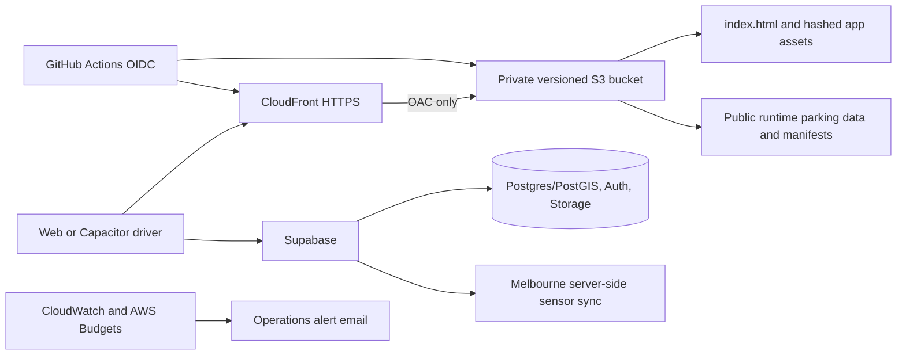

# Bay production architecture

## Current state — audited 19 October 2026

| Component | Current implementation | Production responsibility | Migration disposition |
|---|---|---|---|
| Web application | React 19 + TypeScript + Vite | Browser UI, map, search and country flows | Move from GitHub Pages to CloudFront + private S3 |
| Mobile applications | Capacitor 8 Android and iOS projects | Bundled web UI, geolocation and camera permissions | Retain; no application ID or signing change |
| Parking runtime data | `public/data/` | Regional parking catalogs and lookup indexes | Deploy to private S3 and serve through CloudFront |
| Map tiles | `tile.openstreetmap.org` | Basemap rendering with Leaflet | External dependency; do not mirror without licence/rate review |
| Geocoding | Nominatim | Location search and reverse geocoding | External dependency; do not proxy without approved usage plan |
| Backend | Supabase | Anonymous auth, Postgres/PostGIS RPCs, feedback, visits, sign photos, waitlist | Retain unchanged in phase 1 |
| Melbourne sensor feed | City of Melbourne feed via Supabase jobs | Exact-bay live sensor validation | Retain server-side Supabase sync and its verification rules |
| GitHub Pages | `gh-pages` branch | Existing public pilot | Keep online during staging and cutover |

## Target AWS state



Each environment has one private S3 bucket. CloudFront is its only read principal through Origin Access Control. Its runtime layout is:

```text
/index.html
/assets/                         # Vite immutable, content-hashed assets
/logo/ and /icons/               # product assets
/data/melbourne/                 # runtime regional tiles and index
/data/australia/                 # national AU tiles and index
/data/india/                     # national IN tiles and index
/data/usa/ and /data/sf-meters/  # US and SFMTA runtime tiles/indexes
/manifests/                      # checksummed deployment inventories
```

`VITE_ASSET_BASE_URL` permits the browser to read the same runtime paths from a separate CloudFront domain later, but the initial AWS deployment uses the same CloudFront origin for application and data. This keeps CORS, cache rules and failure modes simple.

## Non-goals in phase 1

- No Supabase database or identity migration.
- No Lambda/API Gateway layer for static parking data.
- No proxying or copying of OpenStreetMap tiles or Nominatim results.
- No booking or payment enablement. The current booking UI only permits verified external operator links; migrations explicitly disable client-created bookings.
- No deletion of GitHub Pages, Supabase data or local source archives.
